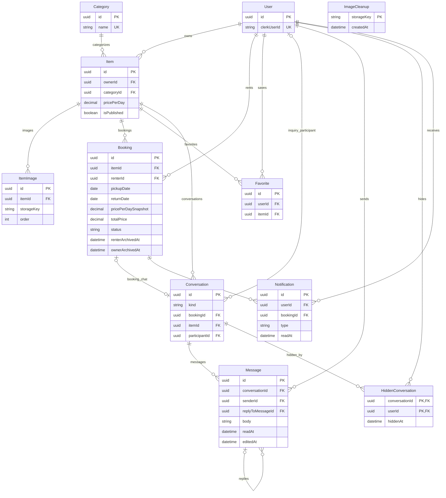

# Финальная проверка и подготовка презентации — 04.11.2026

> Уточнение после объединения PR #65 (`c145ed1`): в документации Яны
> подтверждены обычная регистрация/вход, сверка Render revisions, проверка
> последних Chat/Notification-сценариев, PWA на реальном устройстве и репетиция.
> Эти действия больше не считаются открытыми по сведениям команды.
> Результаты автоматического аудита и отмеченные ниже ограничения относятся
> к снимку `9f235d6` до этого объединения; это не повторная независимая проверка
> ручных действий Яны. Списки подготовки ниже сохранены как памятка, а не новый
> список незавершённых задач. Актуальное завершение — в team-status.md.

## Область проверки

Проверен локальный снимок `9f235d6` в `feat/items-owner-dashboard`, включающий
наши изменения `6ca86e3` и ветку Яны `54f6427`. В ходе проверки обновлены
устаревшие текстовые ожидания auth E2E после нового гостевого экрана Яны.
Бизнес-логика приложения в этом аудите не менялась.

Исходные требования: [документ DCI](final-projekt-info.md),
[план](TODO.md), [обязанности](team-status.md).
Деплой по DCI необязателен; продолжительность выступления — 10–12 минут
и 3–5 минут для вопросов. 20 ноября — внутренний дедлайн команды,
подтверждённой даты экзамена в исходном документе нет.

## Результаты

| Проверка                                                             | Результат                                      |
| -------------------------------------------------------------------- | ---------------------------------------------- |
| Frontend lint, общий Prettier, frontend build                        | Пройдены                                       |
| Server lint/build, Prisma validate                                   | Пройдены                                       |
| Unit: items / notifications / messages+auth presentation             | 20 / 2 / 3 пройдены                            |
| Server unit/API                                                      | 38 пройдены                                    |
| Чистая временная PostgreSQL, миграции и повторный seed               | 47 пройдены                                    |
| Полный UI-прогон                                                     | 96 пройдены                                    |
| Настоящие Clerk/Cloudinary/local API E2E                             | 9 сценариев пройдены (8 + 1; подробности ниже) |
| Общая ссылка: HTTPS, deep link, API health, CORS, категории, каталог | Пройдены, только публичные GET                 |

Первый параллельный E2E-прогон не принят как итог: завершение UI-сервера
остановило frontend, использованный auth-прогоном. Локальный frontend
запущен отдельно, повторный последовательный запуск подтвердил 8 сценариев.
Девятый сценарий ожидал всегда открытый календарь и старую фразу успеха.
После актуализации шагов открытия календаря и disabled-кнопки «Anfrage gesendet»
он отдельно пройден (1/1). Результат — все 9 сценариев проверены после правок,
но это не один непрерывный зелёный запуск всей девятки. Также исправлены
старые ожидания `Bitte melde dich an` и `Anmelden`: теперь проверяются
актуальные гостевые заголовки и `Jetzt anmelden`; добавлен `/account/messages`.
Проверки отсутствия закрытых полей, 401/403 и изоляции аккаунтов сохранены.

Настоящие тесты используют временные Development Clerk-аккаунты и локальную БД.
Фото проходят через Cloudinary; afterAll удаляет только данные своего запуска.
Временные пользователи, тестовые объявления и фото очищены штатными afterAll;
ошибок очистки в принятых запусках нет.
Neon не мигрировался, общие объявления и аккаунты не редактировались.
Официальный Clerk signIn helper не проверяет ввод пароля, email/OTP или OAuth.

Browser-проверка: desktop 1440px, телефон 390×667 и планшет 768×900;
главная, обе темы, закрытие/открытие меню и нижний блок управления.
Автотесты дополняют проверку диапазоном 320–1920px, клавиатурой, touch,
состояниями ошибок, каталогом, формой, галереей и календарём.
Это не полная сертификация WCAG и не проверка VoiceOver/TalkBack.

Замечания для последующей доводки, без изменения согласованного дизайна:

- Светлый слоган #c58a24 на белом имеет расчётный контраст около 2,99:1.
  Для обычного мелкого текста ориентир AA — 4,5:1; исключение логотипа не
  распространяется автоматически на любой сопроводительный текст.
  Текущий оттенок выбран Ольгой и этим аудитом не менялся.
  Источник: [W3C Contrast Minimum](https://www.w3.org/WAI/WCAG22/Understanding/contrast-minimum.html).
- Clerk предупреждает о CSS-селекторах внутренних частей UserButton:
  после обновлений SDK оформление нужно повторно проверять. Новые библиотеки
  ради этого аудита не устанавливались.
- PostgreSQL-драйвер сообщает о будущей несовместимости параллельного client.query
  с pg 9. На закреплённых версиях DB-тесты проходят; обновление major отложить
  в отдельную задачу после демонстрации.
- Текущий CI checks.yml не запускает browser E2E/UI и новый test:messages;
  зелёный CI не заменяет результаты отдельного локального прогона.

## Что выполнено по плану

| Требование                                   | Основание                                                 | Статус                                                   |
| -------------------------------------------- | --------------------------------------------------------- | -------------------------------------------------------- |
| Команда 2–4 человека, fullstack              | Ольга + Яна; вклад Влада сохранён                         | Выполнено                                                |
| Frontend и backend                           | React/TypeScript, Express, Prisma/PostgreSQL              | Выполнено                                                |
| Git, тестирование, план работ                | История Git, CI, TODO, этот прогон                        | Выполнено; финальный remote CI проверить перед релизом   |
| Зона Ольги: объявления, фото, кабинет, права | Owner E2E, API/DB/UI tests, owner-completion.md           | Реализовано                                              |
| Каталог, Booking, цена/пересечения           | Тесты и ранее подтверждённый командой cloud flow          | Реализовано                                              |
| Favorite, Chat, Booking Notifications        | Исходники, контракты, DB/UI tests                         | Реализованы дополнительно к исходному MVP                |
| README и запуск                              | README.md, foundation-setup.md, deployment.md             | Есть; ссылки и формулировки актуализируются этим пакетом |
| ERD                                          | Общая схема ниже; источник — schema.prisma                | Есть                                                     |
| Wireframes основных сценариев                | wireframes/owner-items.md, wireframes/catalog-bookings.md | Есть                                                     |
| Адаптивность и доступность                   | 96 UI tests; ручная визуальная проверка                   | Базовые сценарии проверены; реальные устройства отдельно |
| Презентация 10–12 минут                      | План ниже                                                 | План готов, совместная репетиция ещё нужна               |

Исходная функциональная зона Ольги закрыта. Наполнение сайта можно начинать
через общий Render-адрес. Готовность к окончательной презентации условная:
нужны подтверждение актуального deployment, обычный вход и репетиция.
Оставшиеся действия относятся главным образом к подготовке демонстрации,
а не к написанию новых функций.

## Общая ERD текущей модели

Источник: `server/prisma/schema.prisma`. Показаны все сущности и основные связи;
поля и ограничения полностью определены в Prisma и SQL-миграциях.

`ImageCleanup` — очередь удаления файлов во внешнем хранилище, без FK.
Ключевые ограничения: Favorite(userId,itemId), ItemImage(itemId,order),
Conversation.bookingId, Conversation(itemId,participantId),
HiddenConversation(conversationId,userId), Notification(bookingId,userId,type).
Участники Booking-чата определяются через Booking/Item; отдельной таблицы
участников нет. Inquiry может не иметь Booking. Снимок цены не меняется
при редактировании объявления. День возврата не оплачивается.

## Облачная среда: что доказано и что проверить

Публичный smoke не подтверждает состояние аккаунтов, доступность upload или
номер Render revision. Последний публичный JS entry отличается от локального:
`index-DJXDKNNC.js` против `index-DTfbcDAh.js`. Это повод сверить revision/env,
но не доказательство устаревшего deployment: Vite-хеш зависит и от build env.
Последняя read-only проверка refs показала `main=a31e35e`, ветку Яны `cb693fc`;
последующий fetch завершился SSH-ошибкой. Эти ещё не загруженные коммиты
не входят в локальный прогон. Перед финальным релизом сравнить их diff и CI.

Render Free засыпает после 15 минут простоя, пробуждение — около минуты:
[официальная документация](https://render.com/docs/free).
Перед показом открыть API health и дождаться ответа; держать localhost как резерв.
Clerk Development подходит для демонстрации, не для production:
[официальная документация](https://clerk.com/docs/guides/development/managing-environments).
Manifest и install-иконки есть, service worker/offline не заявляются;
установку и вход на Android/iOS проверить физически:
[web.dev](https://web.dev/learn/pwa/web-app-manifest).
По решению Ольги примерный Impressum и черновик Datenschutz для экзамена
оставляются; юридические тексты не изменялись.

## Следующие шаги Ольги

1. Наполнить общий сайт 8–12 аккуратными объявлениями на немецком:
   разные категории, 3–4 города Германии, реалистичные цены и полные описания.
   Использовать свои/разрешённые фотографии; 2–3 фото на ключевое demo-объявление.
2. Сохранить один подготовленный черновик для показа создания/публикации.
   Отдельную вещь без заявок использовать для демонстрации удаления.
3. Проверить Render revisions frontend/API после финального merge и сверить env.
   Секреты и соединение Neon не пересылать в чат.
4. Подготовить свою часть выступления: owner flow, Cloudinary, deployment,
   изоляция пользователей и сохранность истории. Ключевые данные не удалять
   непосредственно перед показом.

## Следующие шаги команды (Ольга и Яна)

1. Review текущего audit/test-пакета и свежих PR. Направление PR:
   base `main`, compare личная feature-ветка. Сначала синхронизация, затем CI/merge.
2. Яна подтверждает итоговые Chat/Booking/Notification сценарии на общей ссылке;
   проверить новое сообщение и badge двумя аккаунтами после последнего deployment.
   Старый rental flow уже пройден; повторять целиком при изменении Booking/auth/storage.
3. В обычном браузере проверить регистрацию, пароль/OTP или используемый OAuth,
   logout и вход другим аккаунтом. SignIn helper эти шаги не покрывает.
4. Назначить исполнителя короткой проверки PWA на настоящих Android/iOS:
   установка, standalone, вход/выход, клавиатура и safe-area.
5. Провести репетицию 10–12 минут, распределить реплики, подготовить screenshots
   и localhost на случай медленного интернета. Подтвердить дату у преподавателя.
6. Зафиксировать demo-версию и прекратить добавление новых функций до выступления;
   исправлять только найденные блокирующие дефекты.

## План выступления на 11 минут

| Время       | Содержание                                                   | Ведущий                     |
| ----------- | ------------------------------------------------------------ | --------------------------- |
| 0:00–1:00   | Идея RentTogether и кому полезна аренда вещей рядом          | Вместе                      |
| 1:00–2:00   | Команда, роли, вклад Влада, Git/PR и совместная работа       | Вместе                      |
| 2:00–4:30   | Meine Anzeigen: черновик, фото, preview, публикация          | Ольга                       |
| 4:30–7:30   | Каталог, избранное, даты, заявка, подтверждение; чат коротко | Яна, второй аккаунт — Ольга |
| 7:30–9:00   | React/Express/Prisma, ERD, Neon/Render/Cloudinary/Clerk      | Вместе                      |
| 9:00–10:00  | Сложности: пересечение дат, цена-снимок, права и responsive  | Вместе                      |
| 10:00–11:00 | Итог, будущие улучшения и ссылки                             | Вместе                      |

На вопросы — отдельные 3–5 минут. Не показывать каждую настройку и все тесты:
показать один законченный пользовательский сценарий и объяснить его надёжность.
