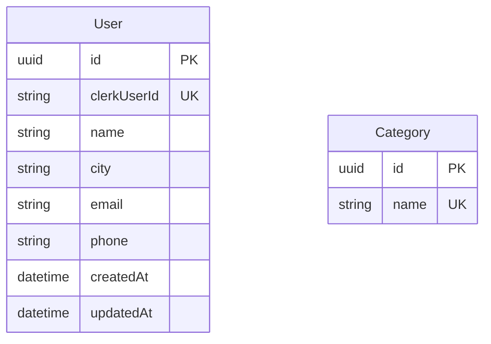

# RentTogether

Full-stack приложение для аренды вещей у соседей. Интерфейс — на немецком,
техническая документация — на русском. Внутренний дедлайн MVP: 20 ноября 2026.

## Запуск

Нужен Node.js 24 и PostgreSQL. Команды ниже выполняются из корня репозитория.
В PowerShell с ограниченной execution policy используйте `npm.cmd` вместо `npm`.

```sh
npm ci
npm --prefix server ci
```

Если PostgreSQL не установлен, запустите переносимую БД отдельной командой:

```sh
npm --prefix server run db:local
```

Она слушает только `127.0.0.1:55432`, сохраняет данные в игнорируемой папке
`server/.local-postgres` и создаёт `server/.env`, если его ещё нет. Существующий
env не перезаписывается. Пароль генерируется случайно и не выводится в лог.
Оставьте терминал открытым, остановка — Ctrl+C. Системная служба/Docker не нужны.
Реализация использует [embedded-postgres](https://github.com/leinelissen/embedded-postgres).

Скопируйте `.env.example` в `.env.local`, а `server/.env.example` в `server/.env`.
Укажите ключи одного Clerk-приложения и URL своей локальной PostgreSQL БД.
Секретный ключ Clerk используется только сервером. В Clerk включите вход по email
и добавьте `http://localhost:5173` в разрешённые origins/redirect URLs.
Без publishable key frontend показывает сообщение настройки; обхода авторизации нет.

```sh
npm --prefix server run db:generate
npm --prefix server run db:deploy
npm --prefix server run db:seed
```

В двух терминалах:

```sh
npm --prefix server run dev
npm run dev
```

Frontend: `http://localhost:5173`, API: `http://localhost:3000/api`.
Health: `GET /api/health` → `{ "status": "ok" }`.

Seed повторно запускается безопасно: создаёт категории, а при заданных
`SEED_OWNER_CLERK_ID` и `SEED_RENTER_CLERK_ID` — локальные профили двух настоящих
Clerk-аккаунтов. Их email обновится при первом авторизованном запросе.
Item и Booking seed добавляют ответственные за эти модели после согласования.

## Контракты для команды

См. [контракты API, auth и маршрутов](contracts.md) и
[UI-гайд](ui.md). Согласованный Ольгой и Яной Item DTO уже находится в
`src/shared/api/types.ts`. По сообщению команды от 28 октября review foundation
пройден без блокирующих замечаний: auth/UI/User/Category и owner routes подтверждены.
Яна подтвердила `/account/bookings/my-rentals` и `/account/bookings/incoming`;
в Router и навигации сохранены эти пути foundation.

Ветки: Влад — `feat/foundation-auth`, Ольга — `feat/items-owner-dashboard`,
Яна — `feat/catalog-bookings`. Общую Prisma-схему меняем последовательно:
User/Category → Item/ItemImage → Booking. Перед следующей миграцией обновляемся
от main. Эта ветка не добавляет Item/Booking или их миграции.

## Проверки

```sh
npm run lint
npm run build
npm --prefix server run lint
npm --prefix server run build
npm --prefix server run db:validate
npm --prefix server test
npm run format:check
npm run test:ui
npm --prefix server run db:check
```

API-тесты используют отдельный HTTP-сервер и подменяют Clerk/репозиторий;
они не требуют ключей и не доказывают подключение к настоящей БД/Clerk.
UI-тесты в Playwright проверяют реальные компоненты в изолированной fixture:
360/390/768/1024/1440 px, переполнение, навигацию, доступные подписи и клавиатуру.
По умолчанию используется установленный Microsoft Edge. Для Linux можно запустить
`npx playwright install chromium` и задать `PLAYWRIGHT_CHANNEL=chromium`.

GitHub Actions выполняет lint, сборки, проверку Prisma, API-тесты и форматирование.
Также CI применяет миграции/seed дважды в отдельной PostgreSQL 18 и запускает
`test:db`. Локальная команда `db:check` делает то же с переносимым PostgreSQL
в новой тестовой БД, проверяя сохранение профилей и разделение двух пользователей.
Она не требует Clerk-ключей: репозиторий настоящий, проверенная Clerk-идентичность
в тестах подменена. Это не заменяет проверку настоящего входа в браузере.
Для реальной проверки миграций на чистой PostgreSQL БД выполните `db:deploy`,
`db:seed`, затем `db:deploy` ещё раз и проверьте отсутствие новых миграций.
После настройки Clerk войдите двумя разными аккаунтами, сохраните профиль,
перезагрузите страницу и убедитесь, что данные не смешиваются между аккаунтами.

Clerk-приложение создаёт Влад в своём [Clerk Dashboard](https://dashboard.clerk.com/).
После создания приложения возьмите Publishable key и Secret key из раздела API keys:
publishable key — в `VITE_CLERK_PUBLISHABLE_KEY` файла `.env.local` и
`CLERK_PUBLISHABLE_KEY` файла `server/.env`, secret key — только в
`CLERK_SECRET_KEY` файла `server/.env`. Не коммитьте эти файлы.

## Структура

- `src/app` — Router и общая конфигурация.
- `src/routes` — file-based routes; `routeTree.gen.ts` генерируется автоматически.
- `src/features` — запросы, формы, сценарии auth/profile/items/catalog/bookings.
- `src/shared/api` — DTO, клиент, общие query keys.
- `src/shared/ui` — atoms, organisms и templates с CSS Modules.
- `server/src/app.ts` — Express app без запуска listener для интеграционных тестов.
- `server/src/index.ts` — конфигурация Clerk/Prisma и запуск API.
- `server/prisma` — схема, миграции и seed.

ERD и wireframes полного MVP остаются отдельной общей задачей команды.
Схема начального этапа:



Clerk интегрирован по [Express quickstart](https://clerk.com/docs/expressjs/getting-started/quickstart)
и [Bearer token requests](https://clerk.com/docs/guides/development/making-requests).
Prisma 7 использует PostgreSQL driver adapter и конфигурацию seed согласно
[документации Prisma](https://www.prisma.io/docs/orm/v7/prisma-migrate/workflows/seeding).
