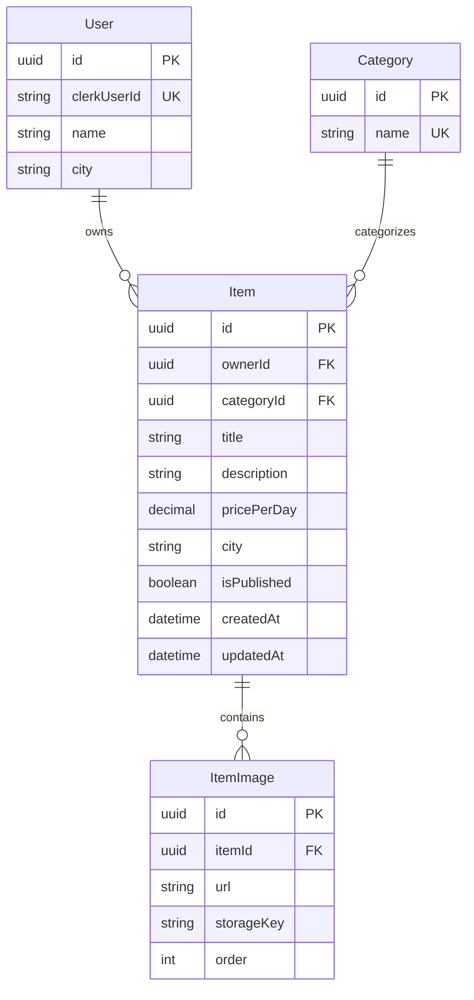

# Этап объявлений с 27 по 30 октября

Разработка этапа Ольги завершена 28 октября 2026 года, на второй рабочий день.
По исходному плану этап включает Item/ItemImage, миграцию, DTO и форму на mock-данных.
Код готов к командному review. Загрузка фото в постоянное хранилище и
подключение frontend к API относятся к следующему этапу.

## Выполнено по плану этапа

- [x] Согласован публичный Item DTO с Яной и интерфейсы foundation с Владом.
- [x] Добавлены Item и ItemImage с UUID-связями User/Category.
- [x] Добавлены createdAt/updatedAt и индексы для сортировки и кабинета владельца.
- [x] Отдельная миграция items проверена после foundation на чистой PostgreSQL.
- [x] Созданы feature items и страницы создания, редактирования и списка.
- [x] Форма на mock-данных проверяет название, описание, город, категорию, цену и фото.
- [x] Работают preview, удаление и перестановка фото в памяти браузера.
- [x] Используются atoms Влада, Inter, SVG и защищённые routes /account/items.
- [x] Подготовлены ERD, API-контракт, команды проверки и дневные отчёты в docs.

## Сделано дополнительно

- Owner API: POST/PATCH/DELETE /api/items и GET /api/my/items.
- Проверка владельца и серверная Zod-валидация; публикация без фото запрещена.
- DELETE безопасно снимает с публикации.
- Идемпотентный seed проектора-черновика для явно выбранного Clerk-пользователя.
- db:check запускает отдельную PostgreSQL на свободном порту и удаляет тестовые данные.

Эти дополнения частично закрывают следующие этапы плана. Весь MVP объявлений
ещё требует серверных фото и подключения API к форме.

## Модель данных

Источник: [schema.prisma](../server/prisma/schema.prisma).
Показаны сущности и связи, используемые объявлениями; Booking добавляет Яна.



Цена хранится в Decimal(8,2), в API выдаётся строкой `"15.50"`. Миграция
запрещает цену <= 0, отрицательный order и повторную позицию внутри одной вещи.
storageKey может быть null; это метаданные будущего хранилища, не публичное поле.
Изображения в PostgreSQL не хранятся бинарно. Удаление связанного владельца или
категории ограничено; удаление строки Item каскадно удаляет только строки ItemImage.
Удаление файлов из хранилища позже обеспечит upload/delete сервис.

## Демонстрационный seed

В `server/.env` опционально указывается `SEED_OWNER_CLERK_ID` — User ID реального
demo-владельца из общего Clerk-приложения. Это не publishable key и не локальный
UUID User. Влад может сообщить ID выбранного demo-аккаунта.

```bash
npm --prefix server run db:deploy
npm --prefix server run db:seed
```

Основной seed создаёт настроенные demo-профили и категории, затем
`server/prisma/seedItems.ts` добавляет проектор за 15,50 EUR/день. Вещь —
неопубликованный черновик без фото, пока не подключено хранилище.

Без SEED_OWNER_CLERK_ID вещь пропускается: seed не выбирает случайного владельца.
Повторный запуск не дублирует объявление, сохраняет его изменения и не меняет
владельца существующего примера. Категории продолжают создаваться без этого флага.
Mock-кабинет пока не читает seed из базы; данные появятся в нём после API-интеграции.

## Проверки

```bash
npm run build
npm run lint
npm run format:check
npm run test:items
npm --prefix server run build
npm --prefix server run lint
npm --prefix server test
npm --prefix server run db:check
```

Наборы тестов: 15 frontend-валидации/фото, 13 API/серверной валидации,
17 PostgreSQL/HTTP/seed. В db:check миграции и seed выполняются дважды;
учётные записи там синтетические и существуют только в отдельной тестовой базе.
Две новые проверки seed подтверждают сохранение изменений и защиту владельца.

Возможен DeprecationWarning pg о будущем изменении query API. Он не является
падением тестов; совместимость нужно повторно проверить перед обновлением pg.
Ручной вход Clerk и сохранение профиля проверены Ольгой; полная интеграция
объявлений с двумя настоящими аккаунтами ещё впереди.

## Передача на review

Схему и миграцию Item следует объединить до добавления миграции Booking.
Яна использует ownerId/categoryId UUID, pricePerDay Decimal(8,2), createdAt
и images.order; публичный DTO остаётся согласованным. Её публичные GET-маршруты
не закрыты owner-auth: он установлен только на конкретных изменяющих методах.

Миграция User/Category не переписывалась. Для нового окружения применяются
обе миграции по порядку. Последние изменения seed и документации нужно отправить
в существующий PR Ольги; review и merge выполняет команда.

## Следующий этап

- [ ] Выбрать постоянное хранилище изображений и способ загрузки.
- [ ] Реализовать upload, удаление и порядок фото с проверкой владельца, размера и содержимого файла.
- [ ] Подключить категории, текущего пользователя и owner API через Query.
- [ ] Сохранить фото на сервере перед публикацией и обработать частичные ошибки загрузки.
- [ ] Проверить сценарий с двумя Clerk-аккаунтами и обновление кешей каталога/кабинета.
- [ ] Подготовить опубликованный seed с настоящим фото и общий демонстрационный сценарий с Booking.
