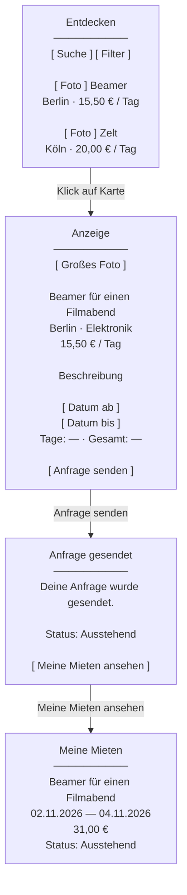

# Wireframe: Katalog und Buchung

## Ziel des Ablaufs

Der Nutzer findet ein veröffentlichtes Item, öffnet dessen Detailseite,
wählt einen Zeitraum und sendet eine Buchungsanfrage. Die neue Anfrage ist
anschließend in `Meine Mieten` mit dem Status `PENDING` sichtbar.
