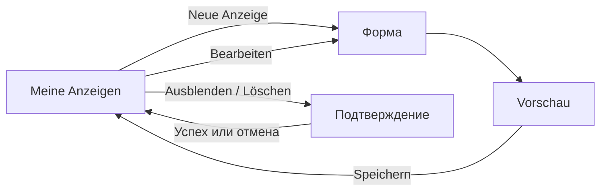

# Wireframes: объявления владельца

Актуальная зона Ольги, 30 октября 2026. Интерфейс на немецком.
Ниже схемы экранов, а не новый дизайн или реализация Booking.

## Meine Anzeigen

```text
Desktop: 3 колонки; mobile: 1 колонка
┌─────────────────────────────────────────────────────────┐
│ Meine Anzeigen                        [+ Neue Anzeige]  │
│ N Anzeigen · veröffentlicht · nicht veröffentlicht       │
├─────────────────┬──────────────────┬────────────────────┤
│ Фото / статус   │ Фото / статус    │ Фото / статус      │
│ Название        │ Название         │ Название           │
│ Город / EUR/Tag │ Город / EUR/Tag  │ Город / EUR/Tag    │
│ [Bearbeiten]    │ [Bearbeiten]     │ [Bearbeiten]       │
│ [Veröffentlichen / Ausblenden]                           │
│ [Löschen]                                               │
└─────────────────────────────────────────────────────────┘
```

Состояния: loading, error с Erneut versuchen, пустой кабинет с Erste Anzeige
и список карточек. Черновик без фото нельзя опубликовать.

## Neue Anzeige / Anzeige bearbeiten

```text
[← Meine Anzeigen]
Neue Anzeige / Anzeige bearbeiten
Название *
Описание *
Город *              Категория *
Цена за день *
Фотографии: [Fotos auswählen]
[Превью] [←] [→] [Entfernen]
[Vorschau anzeigen]
───────────────────────────────────
Предпросмотр: фото, название, описание, город, цена
[Anzeige speichern / Änderungen speichern]
```

На mobile поля в одну колонку; на широком экране город и категория рядом.
Первое неверное поле получает фокус. Ошибки связаны с полями через aria-describedby.
Фотографии переставляются кнопками, доступными с клавиатуры. Preview не публикует
вещь; сохранение новой вещи создаёт черновик.

## Подтверждение действия

```text
Anzeige ausblenden? / Anzeige endgültig löschen?
Название и последствия действия
[ошибка API, если действие не выполнено]
[Abbrechen] [Ausblenden / Endgültig löschen]
```

Начальный фокус — Abbrechen. Escape отменяет действие до начала запроса.
Во время запроса кнопки блокируются. Ошибка остаётся в диалоге.
При наличии Booking окончательное удаление запрещено: сохраняется история.


